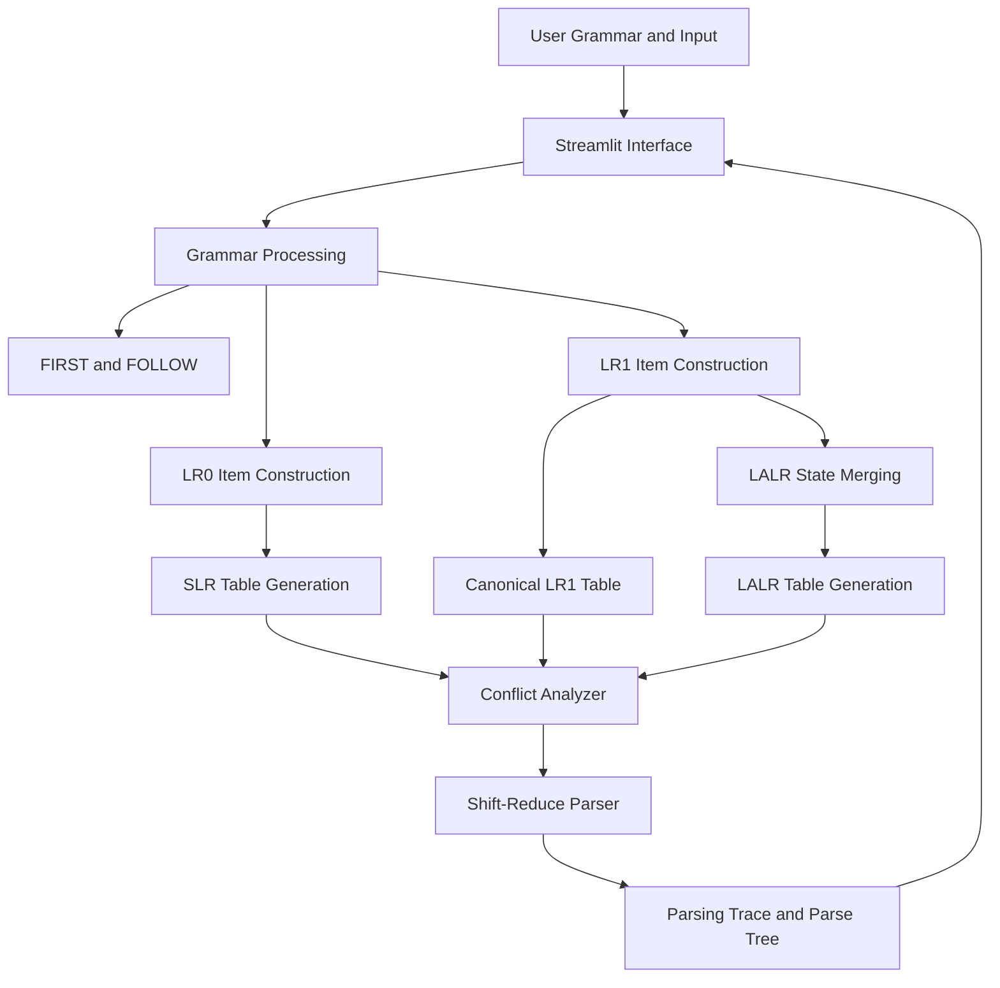

# LR(1) and LALR(1) Parser Workbench with Conflict Analyzer

An interactive Streamlit-based compiler design tool that analyzes context-free grammars, generates SLR(1), Canonical LR(1), and LALR(1) parsing tables, detects parsing conflicts, and demonstrates shift-reduce parsing with parsing traces and parse trees.


---

## Team

| Name                        | Roll Number |
| --------------------------- | ----------- |
| GUNDAPU RAMA YASHO VARSHINI | 24VV1A0523  |
| KAJA KAVYA                  | 24VV1A0527  |
| KANAKAM MOHAN KRISHNAM RAJU | 24VV1A0529  |

* **Problem:** P02 – LR(1) and LALR(1) Parser Workbench with Conflict Analyzer
* **Course:** Compiler Design, 2026–27
* **Project Type:** Team Project (3 Members)

---

## 1. Problem Statement

Constructing LR parsing tables manually is time-consuming and makes it difficult to understand the differences between parsing techniques. Students often find it challenging to visualize LR item sets, understand parsing conflicts, and determine why a grammar is accepted by one parser but rejected by another.

This project provides an interactive workbench that automates grammar analysis and generates parsing tables for SLR(1), Canonical LR(1), and LALR(1). It identifies shift-reduce and reduce-reduce conflicts and provides detailed information about the corresponding parsing states and items.

The application also demonstrates shift-reduce parsing through step-by-step parsing traces and parse-tree visualization, helping students understand bottom-up parsing concepts practically.

## 2. Background Theory

LR parsing is a bottom-up parsing technique that reads input from left to right and constructs a rightmost derivation in reverse.

An LR parser uses two important tables:

* **ACTION Table:** Determines whether to shift, reduce, accept, or report an error.
* **GOTO Table:** Determines the next state after a reduction to a nonterminal.

### 2.1 LR(0) Items

An LR(0) item represents a production with a dot indicating the current parsing position.

Example:

```text
A -> X . Y
```

The parser has recognized `X` and expects `Y` next.

### 2.2 SLR(1) Parsing

Simple LR parsing uses LR(0) item sets and FOLLOW sets to determine where reduction actions should be placed.

### 2.3 Canonical LR(1) Parsing

Canonical LR(1) items contain a one-symbol lookahead. This provides more precise reduction decisions and supports a larger class of grammars than SLR(1).

### 2.4 LALR(1) Parsing

LALR(1) merges Canonical LR(1) states that have identical LR(0) cores.

This reduces the number of states while retaining much of the parsing power of Canonical LR(1). However, state merging can introduce reduce-reduce conflicts.

### 2.5 Parsing Conflicts

* **Shift-Reduce Conflict:** Occurs when a parser can either shift the next input symbol or reduce a production.
* **Reduce-Reduce Conflict:** Occurs when two different productions compete for reduction in the same state and lookahead.

### 2.6 Worked Example

Consider the grammar:

```text
S -> C C
C -> c C | d
```

**Step 1: Augment the grammar**

```text
S' -> S
```

**Step 2: Construct the initial item set**

```text
S' -> . S
S  -> . C C
C  -> . c C
C  -> . d
```

**Step 3: Construct transitions**

When the parser reads `d`, it can reach a state containing:

```text
C -> d .
```

This completed item indicates that the production can be reduced.

**Step 4: Perform reduction**

The parser consults the ACTION table to determine whether the reduction is valid. After reducing `d` to `C`, it uses the GOTO table to find the next state.

**Step 5: Parse the input**

Input:

```text
d d
```

Expected result: **Input Accepted**

Both `d` symbols derive `C`, and the production `S -> C C` derives the complete input.

### 2.7 Advanced Example: LR(1) but Not LALR(1)

Consider:

```text
S -> a A d | b A e | a B e | b B d
A -> c
B -> c
```

Canonical LR(1) maintains separate lookahead contexts and can construct a conflict-free parsing table for this grammar.

LALR(1) merges states with identical LR(0) cores. This can combine the lookaheads for the completed productions `A -> c` and `B -> c`, introducing reduce-reduce conflicts.

This example demonstrates the difference between Canonical LR(1) and LALR(1).

---

## 3. Features

### Required Features

* [x] SLR(1) parsing-table generation.
* [x] Canonical LR(1) parsing-table generation.
* [x] LALR(1) parsing-table generation.
* [x] Shift-reduce conflict detection.
* [x] Reduce-reduce conflict detection.
* [x] Display related parsing states and items.

### Additional Features

* [x] Interactive context-free grammar input.
* [x] Grammar productions using `->` or `→`.
* [x] Alternative productions using `|`.
* [x] Epsilon production support using `ε`.
* [x] FIRST and FOLLOW set computation.
* [x] LR item-set visualization.
* [x] DFA transition display.
* [x] ACTION and GOTO table visualization.
* [x] Shift-reduce parsing demonstration.
* [x] Step-by-step parsing trace.
* [x] Parse-tree generation for accepted inputs.
* [x] Operator precedence handling where implemented.

*Note: Features are marked as implemented based on the project version; verify them against the submitted code.*

---

## 4. Architecture

The application follows a modular architecture. Each module is responsible for a specific compiler-design operation.

### 4.1 Architecture Diagram



### 4.2 Main Modules

| Module            | Responsibility                        |
| ----------------- | ------------------------------------- |
| `app.py`          | Streamlit user interface              |
| `grammar.py`      | Grammar representation and processing |
| `first_follow.py` | FIRST and FOLLOW computation          |
| `lr0.py`          | LR(0) item-set construction           |
| `lr1.py`          | Canonical LR(1) item-set construction |
| `slr.py`          | SLR parsing implementation            |
| `lr1_table.py`    | Canonical LR(1) table generation      |
| `lalr.py`         | LALR state merging                    |
| `lalr_table.py`   | LALR parsing-table generation         |
| `precedence.py`   | Operator precedence handling          |
| `parser.py`       | Shift-reduce parsing                  |
| `parse_tree.py`   | Parse-tree construction               |

*The table describes the expected module responsibilities. Retain only files that exist in the submitted project.*

### 4.3 Key Data Structures

* **Grammar:** Maps nonterminals to their production alternatives.
* **LR(0) Item:** `(lhs, rhs_tuple, dot_position)`.
* **LR(1) Item:** `(lhs, rhs_tuple, dot_position, lookahead)`.
* **State Collection:** Collection of item sets.
* **Transitions:** Maps `(state, grammar_symbol)` to a destination state.
* **ACTION/GOTO:** Tables used to determine parsing actions and state transitions.
* **Conflict:** Stores conflicting actions and their corresponding state and lookahead.
* **Parse Tree Node:** Represents a grammar symbol and its children.

---

## 5. Installation

### Requirements

* Python 3.10 or later.
* pip package manager.
* Streamlit.
* pandas.
* Other dependencies specified in `requirements.txt`.

### Windows Installation

Open PowerShell in the project directory containing `app.py`.

Create a virtual environment:

```powershell
py -m venv .venv
```

Activate it:

```powershell
.venv\Scripts\Activate.ps1
```

Install dependencies:

```powershell
python -m pip install -r requirements.txt
```

### Run the Application

```powershell
python -m streamlit run app.py
```

Open the local application in your browser:

```text
http://localhost:8501
```

---

## 6. Usage

1. Launch the Streamlit application.
2. Enter a context-free grammar in the grammar input area.
3. Select one of the parsing techniques:

   * SLR(1)
   * Canonical LR(1)
   * LALR(1)
4. Click **Analyze Grammar**.
5. Inspect FIRST and FOLLOW sets.
6. View LR item sets and DFA transitions.
7. Examine the generated ACTION/GOTO parsing tables.
8. Inspect the Conflict Analyzer.
9. Enter an input string.
10. Click **Parse Input**.
11. View the parsing trace and parse tree if the input is accepted.

### Example 1: Basic Grammar

Grammar:

```text
S -> C C
C -> c C | d
```

Input:

```text
d d
```

Expected result:

```text
Input Accepted
```

### Example 2: Arithmetic Expression Grammar

Grammar:

```text
E -> E + T | T
T -> T * F | F
F -> ( E ) | id
```

Input:

```text
id + id * id
```

Expected result:

```text
Input Accepted
```

The grammar structure gives multiplication higher precedence than addition.

### Example 3: Invalid Input

Grammar:

```text
E -> E + T | T
T -> T * F | F
F -> ( E ) | id
```

Input:

```text
id + * id
```

Expected result:

```text
Input Rejected
```

---

## 7. Examples and Results

The following are expected results to verify against the final application.

| Test Case                     | Parser          | Expected Result                         |
| ----------------------------- | --------------- | --------------------------------------- |
| Basic grammar: `d d`          | SLR(1)          | Accepted                                |
| Basic grammar: `d d`          | Canonical LR(1) | Accepted                                |
| Basic grammar: `d d`          | LALR(1)         | Accepted                                |
| Arithmetic expression         | All three       | Accepted                                |
| Invalid expression            | All three       | Rejected                                |
| Ambiguous expression grammar  | All three       | Shift-reduce conflict before resolution |
| LR(1)-but-not-LALR(1) grammar | Canonical LR(1) | No conflicts                            |
| LR(1)-but-not-LALR(1) grammar | LALR(1)         | Reduce-reduce conflicts                 |

### Parser Comparison

| Characteristic      | SLR(1)          | Canonical LR(1)      | LALR(1)                    |
| ------------------- | --------------- | -------------------- | -------------------------- |
| Item basis          | LR(0)           | LR(1)                | Merged LR(1)               |
| Reduction lookahead | FOLLOW sets     | Individual lookahead | Merged lookahead           |
| Number of states    | Usually smaller | Usually larger       | Usually smaller than LR(1) |
| State merging       | Not applicable  | No merging           | Equal LR(0) cores          |
| Parsing power       | Lower           | Higher               | Higher than SLR(1)         |

### Actual Results

Record the actual state and conflict counts from the submitted application.

| Grammar                       | SLR(1) States / Conflicts | Canonical LR(1) States / Conflicts | LALR(1) States / Conflicts |
| ----------------------------- | ------------------------- | ---------------------------------- | -------------------------- |
| Basic grammar                 | Add measured values       | Add measured values                | Add measured values        |
| Expression grammar            | Add measured values       | Add measured values                | Add measured values        |
| LR(1)-but-not-LALR(1) grammar | Add measured values       | Add measured values                | Add measured values        |

Do not report estimated benchmark values as measured results.

---

## 8. Screenshots

Screenshots of the application are available in the `docs/screenshots/` directory.

### Application Interface


### FIRST and FOLLOW Sets


### Parsing Tables


### Conflict Analyzer


---

## 9. Testing

### Syntax Check

Run:

```powershell
python -m compileall .
```

### Application Launch Test

```powershell
python -m streamlit run app.py
```

### Functional Test Coverage

The following operations should be tested:

* FIRST and FOLLOW set computation.
* LR(0) item-set construction.
* Canonical LR(1) item-set construction.
* LALR state merging.
* SLR, LR(1), and LALR parsing-table generation.
* Shift-reduce conflict detection.
* Reduce-reduce conflict detection.
* Valid input acceptance.
* Invalid input rejection.
* Operator precedence handling.
* Parse-tree generation.
* Epsilon production handling, if supported.

*The commands above provide a syntax check and application launch. They do not replace a dedicated automated test suite.*

---

## 10. Limitations and Future Work

### Current Limitations

* Designed as an educational tool rather than a production compiler.
* Some grammar inputs may require whitespace-separated tokens.
* Error recovery is limited.
* Operator precedence rules cannot resolve every possible grammar conflict.
* Formal runtime and memory benchmarks have not been recorded.

### Future Enhancements

* Add automated unit and integration tests.
* Improve syntax-error reporting and error recovery.
* Support exporting parsing tables.
* Add customizable operator precedence and associativity.
* Improve parse-tree visualization.
* Add grammar validation.
* Compare parser performance across larger grammars.

---

## 11. Demo Video

**Demo Video:** [C:\Users\Rama Yasho Varshini\OneDrive\Desktop\Submissions\PO2\docs]

The demonstration covers:

1. Launching the application.
2. Entering a context-free grammar.
3. Computing FIRST and FOLLOW sets.
4. Generating SLR(1), Canonical LR(1), and LALR(1) tables.
5. Demonstrating conflict detection.
6. Parsing valid and invalid input strings.
7. Viewing parsing traces and parse trees.
8. Comparing Canonical LR(1) and LALR(1).

---

## 12. Credits and References

1. Aho, A. V., Lam, M. S., Sethi, R., and Ullman, J. D. *Compilers: Principles, Techniques, and Tools*, 2nd Edition, Pearson.
2. Python Documentation: https://docs.python.org/3/
3. Streamlit Documentation: https://docs.streamlit.io/
4. pandas Documentation: https://pandas.pydata.org/docs/
5. Compiler Design course materials and lecture notes.

### AI Assistance

OpenAI ChatGPT was used for assistance with compiler-design concept explanations, documentation preparation, and code troubleshooting. The team reviewed the project implementation and is responsible for verifying the final submitted work.

---

## 13. Submission Checklist

* [x] Three team members listed.
* [x] Official problem title and number included.
* [x] Project description and background theory included.
* [x] Architecture documented.
* [x] Installation and usage instructions included.
* [x] Demo GIF added.
* [ ] Verify all screenshots display correctly.
* [ ] Record actual parser state and conflict counts.
* [ ] Add demo video link.
* [ ] Verify all dependencies in `requirements.txt`.
* [ ] Ensure `.venv/` and `__pycache__/` are excluded from Git.
* [ ] Verify all project source files are included.
* [ ] Push the completed project to `submissions/P02/`.

---

**Course:** Compiler Design, 2026–27
**Problem:** P02 – LR(1) and LALR(1) Parser Workbench with Conflict Analyzer

**Developed as a three-member team project.**
