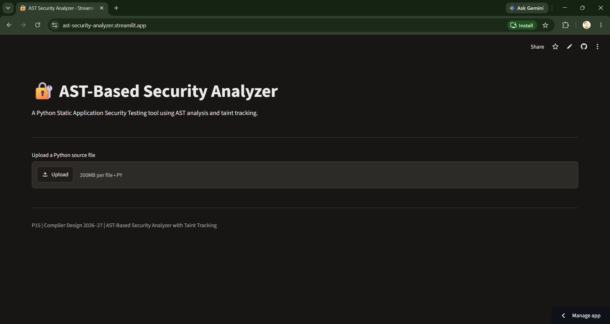
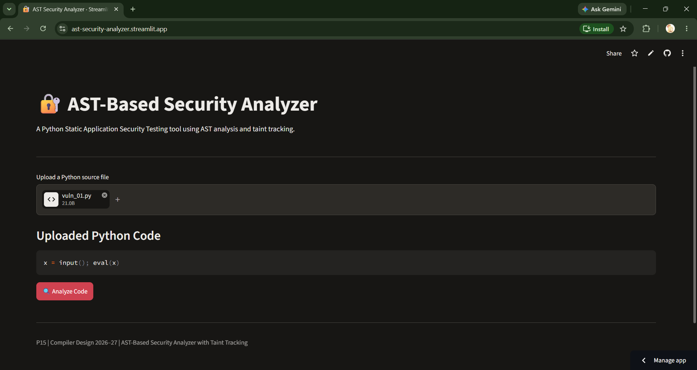
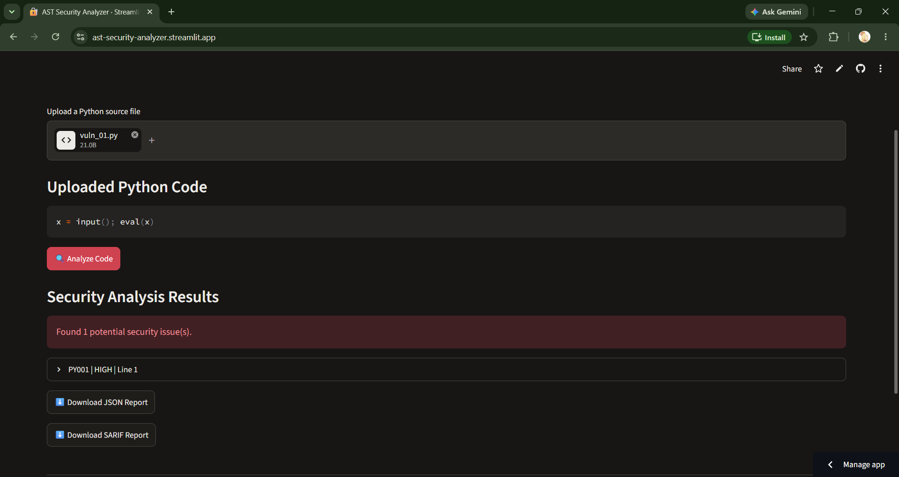
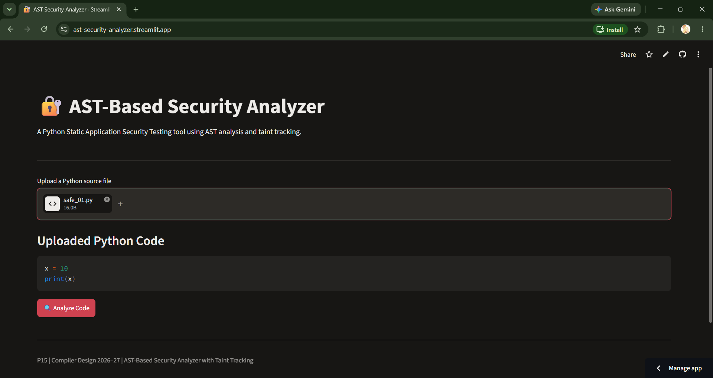
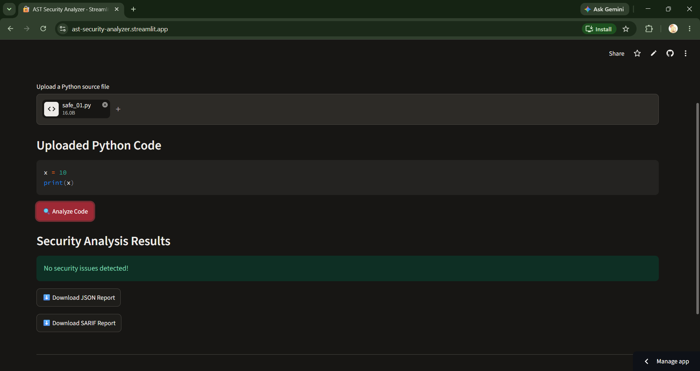

# 🔐 AST-Based Security Analyzer with Taint Tracking

A Python-based Static Application Security Testing (SAST) tool that uses **Abstract Syntax Tree (AST) analysis** and **taint tracking** to identify potentially insecure coding practices and security vulnerabilities in Python programs.

## 🚀 Live Demo

**Try the deployed application here:**

🔗 **[AST-Based Security Analyzer – Live Application](https://ast-security-analyzer.streamlit.app/)**

The application is deployed using Streamlit Community Cloud. Users can upload Python source files, analyze them for potential security vulnerabilities, and download the analysis reports in JSON and SARIF formats.

## 👥 Team Members

| S. No. | Name | Roll Number |
|:---:|---|:---:|
| 1 | ANIMALLA MAHATHI DEVI | 24VV1A0505 |
| 2 | BIDDIKA MEGHANA | 24VV1A0509 |
| 3 | UVVA VENNELA | 25VV5A0573 |

**Problem Number:** P15 – AST-Based Security Analyzer with Taint Tracking  
**Course:** Compiler Design, 2026–27

---

## 1. Problem Statement

Develop a Static Application Security Testing (SAST) tool for Python or JavaScript that detects common security vulnerabilities using Abstract Syntax Tree analysis and taint tracking.

The tool should identify dangerous coding practices, trace potentially untrusted data from sources to sensitive operations, and generate structured vulnerability reports.

The analyzer should support configurable security rules and provide reports containing vulnerability identifiers, severity levels, affected line numbers, and relevant descriptions.

## 2. Background Theory

### 2.1 Static Application Security Testing (SAST)

Static Application Security Testing analyzes source code without executing the program. It helps identify security weaknesses during development.

### 2.2 Abstract Syntax Tree (AST)

An Abstract Syntax Tree is a tree representation of source code that describes its syntactic structure.

Python provides the built-in `ast` module to parse source code into an AST. The analyzer traverses this structure to identify potentially dangerous function calls and coding patterns.

### 2.3 Taint Analysis

Taint analysis tracks data that originates from untrusted sources and determines whether it reaches sensitive operations without appropriate sanitization.

The analyzer uses:

- **Sources:** Functions that introduce potentially untrusted data, such as `input()`.
- **Sanitizers:** Operations that are intended to make data safe.
- **Sinks:** Sensitive operations that may be vulnerable when they receive untrusted data, such as SQL queries and OS command execution.

### 2.4 Worked Example

Consider the following Python code:

```python
user_input = input("Enter expression: ")
result = eval(user_input)
```

**Analysis:**

1. `input()` receives data from an untrusted user.
2. The returned value is assigned to `user_input`.
3. The value is passed to `eval()`.
4. The analyzer identifies the dangerous operation.
5. A security finding is generated with its rule identifier, severity, and line number.

This demonstrates how AST-based pattern detection and taint tracking can help identify potentially unsafe code.

## 3. Features

- **AST-Based Analysis:** Parses Python source code using the built-in AST module.
- **Dangerous Function Detection:** Identifies potentially unsafe uses of `eval()` and `exec()`.
- **Shell Command Detection:** Detects command execution patterns involving `shell=True`.
- **Hard-Coded Secret Detection:** Identifies potentially hard-coded credentials and secrets.
- **Weak Hash Detection:** Identifies the use of weak hashing algorithms such as MD5 and SHA-1.
- **Insecure Deserialization Detection:** Identifies potentially unsafe uses of `pickle.loads()`.
- **Taint Tracking:** Tracks untrusted data from sources to sensitive operations.
- **YAML-Based Security Rules:** Loads configurable security rules from a YAML file.
- **Interactive Web Interface:** Provides a Streamlit-based interface for uploading and analyzing Python files.
- **JSON Reports:** Generates downloadable JSON vulnerability reports.
- **SARIF Reports:** Generates reports in Static Analysis Results Interchange Format (SARIF) 2.1.0.
- **Command-Line Interface:** Supports analysis through the terminal.

## 4. System Architecture

The analyzer follows a modular architecture.

### 4.1 Architecture Flow

```text
       Python Source Code
               |
               v
       Input / File Upload
               |
               v
          AST Parser
               |
               v
       AST Representation
               |
          +----+----+
          |         |
          v         v
    Pattern-Based  Taint
     Detection    Analysis
          |         |
          +----+----+
               |
               v
       Security Findings
               |
               v
        Report Generator
               |
          +----+----+
          |         |
          v         v
       JSON       SARIF
       Report     Report
```

### 4.2 Main Modules

| Module | Description |
|---|---|
| `app.py` | Provides the Streamlit web interface. |
| `main.py` | Provides command-line execution of the analyzer. |
| `ast_parser.py` | Parses Python source files into AST structures. |
| `security_rules.py` | Loads configurable security rules from YAML. |
| `vulnerability_detector.py` | Detects potentially insecure coding patterns. |
| `taint_analyzer.py` | Performs intraprocedural taint analysis. |
| `report_generator.py` | Generates JSON and SARIF reports. |
| `rules/security_rules.yaml` | Contains configurable security rules. |
| `tests/test_analyzer.py` | Contains automated test cases. |

### 4.3 Data Structures

The project uses the following data structures:

- **AST Nodes:** Represent functions, expressions, assignments, and other Python language constructs.
- **Dictionaries:** Store vulnerability information such as rule IDs, messages, severity, file names, and line numbers.
- **Lists:** Store security findings and report results.
- **Sets:** Support tracking of tainted variables.
- **YAML Configuration:** Stores security rule definitions separately from the detection logic.

## 5. Technologies Used

| Technology | Purpose |
|---|---|
| Python | Core implementation |
| Python AST | Source code parsing |
| Streamlit | Interactive web interface |
| PyYAML | YAML security rule configuration |
| Pytest | Automated testing |
| Coverage.py | Code coverage measurement |
| JSON | Structured vulnerability reports |
| SARIF 2.1.0 | Standardized static analysis reports |
| Git and GitHub | Version control and project hosting |
| Streamlit Community Cloud | Application deployment |

## 6. Project Structure

```text
ast-security-analyzer/
│
├── app.py
├── main.py
├── ast_parser.py
├── security_rules.py
├── taint_analyzer.py
├── vulnerability_detector.py
├── report_generator.py
│
├── requirements.txt
├── README.md
│
├── rules/
│   └── security_rules.yaml
│
├── examples/
│   ├── safe.py
│   └── vulnerable.py
│
├── tests/
│   ├── test_analyzer.py
│   ├── vulnerable/
│   │   ├── vuln_01.py
│   │   ├── ...
│   │   └── vuln_20.py
│   │
│   └── safe/
│       ├── safe_01.py
│       ├── ...
│       └── safe_20.py
│
├── docs/
│   ├── architecture/
│   │   └── architecture.md
│   └── screenshots/
│
└── reports/
```

## 7. Installation and Setup

### 7.1 Prerequisites

- Python 3.10 or above
- pip package manager
- Git
- Visual Studio Code (recommended)

### 7.2 Clone the Repository

```bash
git clone https://github.com/meg-2117/ast-security-analyzer.git
```

Navigate to the project directory:

```bash
cd ast-security-analyzer
```

### 7.3 Install Dependencies

```bash
pip install -r requirements.txt
```

### 7.4 Run the Web Application

```bash
streamlit run app.py
```

The application will open in your browser. If it does not open automatically, visit:

```text
http://localhost:8501
```

## 8. Usage

### 8.1 Web Application

1. Open the deployed application or run it locally.
2. Click the Upload button.
3. Select a Python source file (`.py`).
4. Review the uploaded source code.
5. Click **Analyze Code**.
6. Review the security findings.
7. Download the JSON or SARIF report.

**Live Application:** https://ast-security-analyzer.streamlit.app/

### 8.2 Command-Line Usage

To analyze a Python file:

```bash
python main.py examples/vulnerable.py
```

To generate a JSON report:

```bash
python main.py examples/vulnerable.py --format json --output reports/report.json
```

To generate a SARIF report:

```bash
python main.py examples/vulnerable.py --format sarif --output reports/report.sarif
```

To analyze a directory of vulnerable test files:

```bash
python main.py tests/vulnerable --format json --output vulnerable_report.json
```

To analyze safe test files:

```bash
python main.py tests/safe --format json --output safe_report.json
```

## 9. Screenshots and Results

The following screenshots demonstrate the application interface and its analysis results.

### 9.1 Application Home Page

The home page provides the Python source file upload interface.



### 9.2 Vulnerable File Upload

This screenshot demonstrates uploading a Python file containing potentially vulnerable code.



### 9.3 Vulnerability Detection Results

The analyzer identifies security vulnerabilities and displays their severity and relevant details.



### 9.4 Safe File Upload

This screenshot demonstrates uploading a Python file containing safe code for analysis.



### 9.5 Safe Scan Results

The analyzer processes the safe file and displays the scan results without reporting security issues.



## 10. Testing and Evaluation

The analyzer was evaluated using separate vulnerable and safe Python test fixtures.

### 10.1 Test Dataset

| Test Category | Number of Files |
|---|---:|
| Vulnerable Python files | 20 |
| Safe Python files | 20 |
| Total test files | 40 |

### 10.2 Automated Testing

The project uses Pytest for automated testing.

Run the test suite:

```bash
python -m pytest -q
```

**Observed result:**

```text
40 passed
```

### 10.3 Code Coverage

Coverage was measured using Coverage.py.

Run:

```bash
python -m coverage run -m pytest
python -m coverage report -m
```

**Observed result:**

| Metric | Result |
|---|---:|
| Total statements | 353 |
| Missed statements | 0 |
| Statement coverage | 100% |

### 10.4 Fixture-Based Evaluation

The following results were observed when scanning the prepared test fixtures:

| Metric | Result |
|---|---:|
| True Positives (TP) | 20 |
| False Negatives (FN) | 0 |
| True Negatives (TN) | 20 |
| False Positives (FP) | 0 |

These values describe the prepared fixture dataset only. They should not be interpreted as real-world detection accuracy or a guarantee that all vulnerabilities will be detected.

### 10.5 SARIF Validation

The generated SARIF report was checked for its JSON structure and key fields.

Observed output:

- SARIF version: 2.1.0
- Number of runs: 1
- Number of results: 20
- Tool name: AST Security Analyzer

## 11. Limitations

- The current implementation focuses on Python source code.
- Taint analysis is intraprocedural and does not provide complete interprocedural tracking across function calls.
- Static analysis may produce false positives and false negatives.
- Detection depends on the implemented patterns and configured security rules.
- The analyzer does not execute the uploaded Python program.
- A clean result does not guarantee that the source code is completely secure.
- The current implementation is an academic prototype and is not a replacement for comprehensive professional security auditing.

## 12. Future Enhancements

- Implement interprocedural taint analysis using call graphs.
- Expand support for additional vulnerability patterns.
- Improve sanitization and data-flow tracking.
- Add support for JavaScript source code.
- Improve false-positive and false-negative evaluation using larger datasets.
- Integrate additional security analysis tools such as Bandit for comparative evaluation.
- Improve SARIF compatibility and integration with GitHub code scanning.
- Extend the web interface with additional filtering and visualization features.

## 13. Deployment

The application is publicly deployed using **Streamlit Community Cloud**.

**Deployment URL:**

🔗 https://ast-security-analyzer.streamlit.app/

**GitHub Repository:**

🔗 https://github.com/meg-2117/ast-security-analyzer

The deployed application allows users to upload Python files, run security analysis, view findings, and download reports without installing the project locally.

## 14. Credits and References

1. Python Documentation – Abstract Syntax Trees: https://docs.python.org/3/library/ast.html
2. Streamlit Documentation: https://docs.streamlit.io/
3. PyYAML Documentation: https://pyyaml.org/wiki/PyYAMLDocumentation
4. Pytest Documentation: https://docs.pytest.org/
5. SARIF Specification: https://sarifweb.azurewebsites.net/
6. Common Weakness Enumeration (CWE): https://cwe.mitre.org/
7. GitHub Documentation: https://docs.github.com/

---

**Project:** P15 – AST-Based Security Analyzer with Taint Tracking  
**Course:** Compiler Design, 2026–27  
**Institution:** JNTU-GV College of Engineering Vizianagaram

**Developed by:**  
ANIMALLA MAHATHI DEVI | BIDDIKA MEGHANA | UVVA VENNELA

