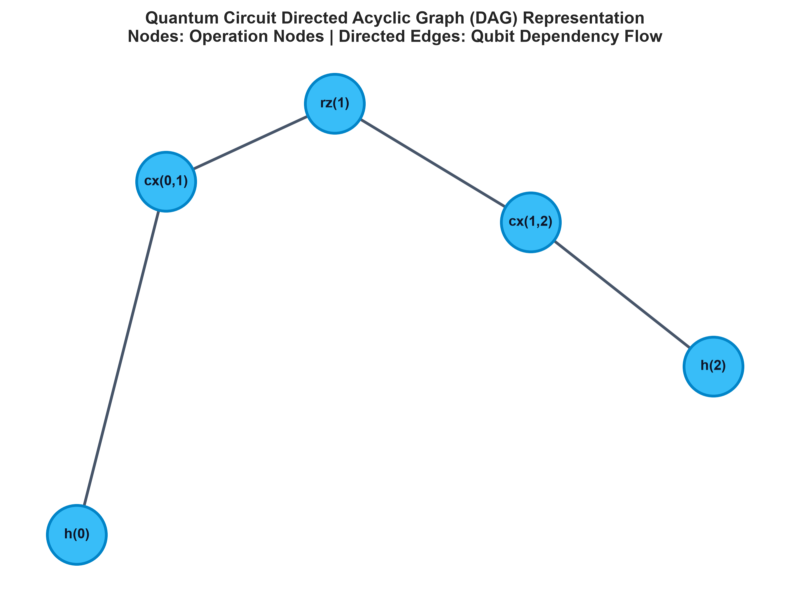
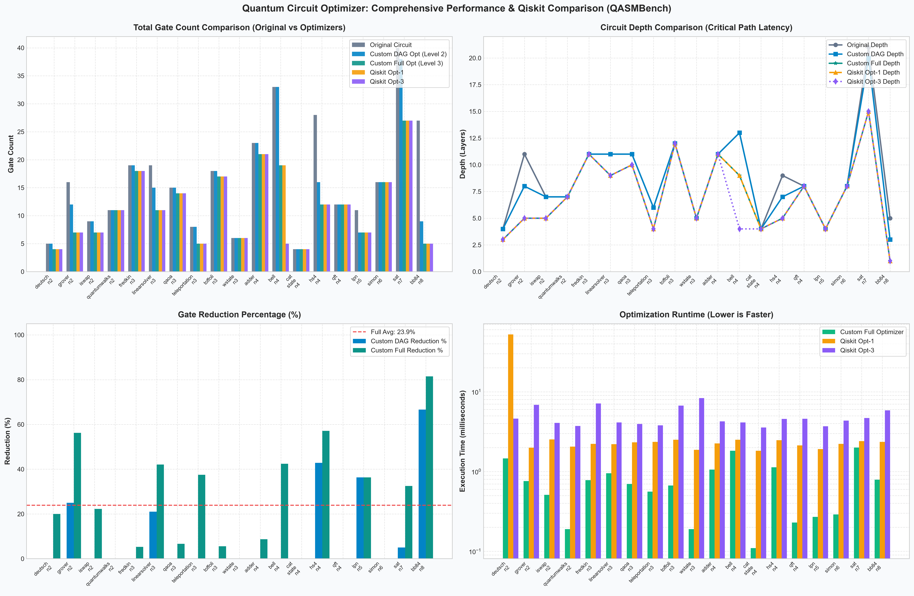
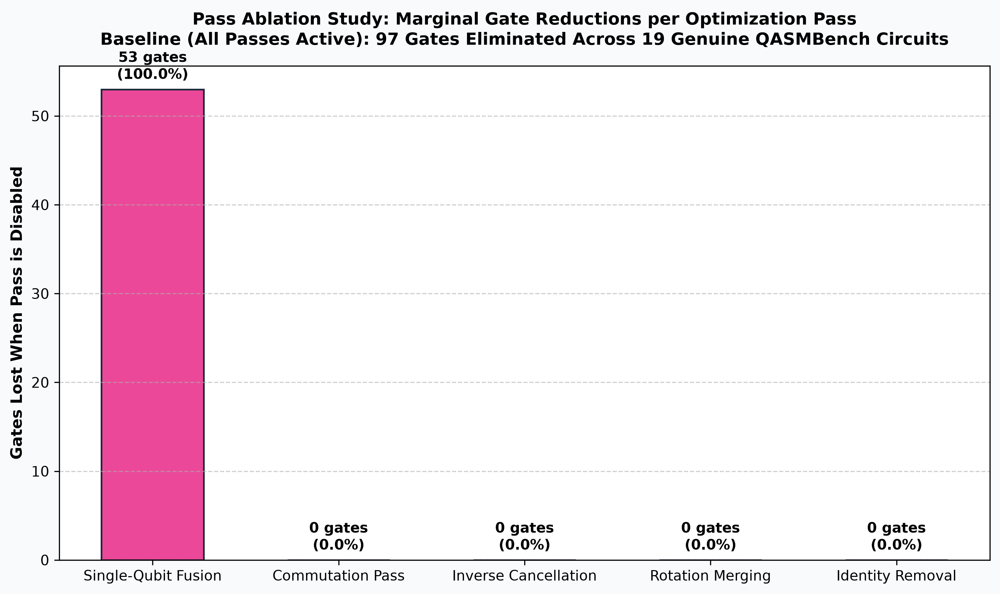

# Quantum Circuit Optimizer: Peephole and DAG-Based Optimization

**Course:** Compiler Design (Track E: Quantum Computing Track)  
**Assignment Problem:** Problem 19 — Quantum Circuit Optimizer (Peephole and DAG-Based)  
**Environment:** Python 3.12+ / 3.13 | Qiskit 2.x | NetworkX | Matplotlib | Pandas | SciPy  

---

## 1. Project Overview & Objective

In quantum computation, physical quantum processors (Noisy Intermediate-Scale Quantum hardware — NISQ) operate under strict coherence time constraints and exhibit gate infidelities, particularly for two-qubit entangling gates ($CX$). Optimizing quantum circuits prior to execution on quantum hardware is directly analogous to middle-end and backend compiler optimization in classical systems (such as LLVM or GCC).

This project transfers classical compiler optimization principles—specifically **Peephole Optimization**, **Directed Acyclic Graph (DAG) Dependency Analysis**, **Algebraic Simplification**, **Commutation-Based Gate Reordering**, and **Single-Qubit Gate Fusion**—to a Quantum Intermediate Representation (IR).

### Core Goals
1. **Peephole Optimization:** Local sliding-window algebraic pattern matching and inverse cancellation.
2. **DAG-Based Optimization:** Conversion of quantum circuits to a Directed Acyclic Graph (DAG) where nodes represent gate operations and directed edges trace quantum wire dependencies.
3. **Commutation-Based Reordering:** Pushing gates past commuting multi-qubit and single-qubit operations along DAG wires to expose previously occluded cancellation opportunities.
4. **Single-Qubit Gate Fusion:** Combining adjacent single-qubit rotations into canonical $U(\theta, \phi, \lambda)$ unitaries while strictly preserving global phase.
5. **Pass Manager with Fixed-Point Convergence:** An iterative compiler pass pipeline that executes transformation passes until reaching a fixed point where no further reductions occur.
6. **Strict Mathematical Equivalence:** Rigorous unitary matrix equivalence verification ($\frac{|\text{Tr}(U_1^\dagger U_2)|}{2^n} = 1.0$) up to global phase via Qiskit's `Operator.equiv`.
7. **Empirical Benchmarking on Genuine Circuits:** Evaluation across 19 genuine quantum circuits sourced from **PNNL QASMBench** (2 to 8 qubits), comparing against IBM's industry-standard Qiskit Transpiler (Optimization Levels 1 and 3).

---

## 2. Theoretical Architecture & Optimization Passes

```
                          [Quantum Circuit / OpenQASM 2.0]
                                          │
                                          ▼
                             [Circuit-to-DAG Converter]
                                          │
          ┌───────────────────────────────┴───────────────────────────────┐
          │                                                               │
          ▼                                                               ▼
┌─────────────────────────────────┐             ┌───────────────────────────────────┐
│     Peephole Optimization       │             │       DAG-Based Optimization      │
│  - Linear sliding-window scan   │             │  - Wire dependency tracing        │
│  - H-H = I, X-X = I, Z-Z = I    │             │  - Commutation along wires        │
│  - Adjacent rotation merging    │             │  - Cross-wire independence check  │
│  - Zero-angle identity removal  │             │  - Safe multi-qubit cancellation  │
└─────────────────────────────────┘             └───────────────────────────────────┘
          │                                                               │
          └───────────────────────────────┬───────────────────────────────┘
                                          ▼
                              [Iterative Pass Manager]
                      ┌───────────────────────────────────────┐
                      │  Pass 1: Identity Removal             │
                      │  Pass 2: Inverse Cancellation         │
                      │  Pass 3: Rotation Merging             │
                      │  Pass 4: Commutation-Based Rewriting  │
                      │  Pass 5: Single-Qubit Gate Fusion     │
                      └───────────────────┬───────────────────┘
                                          │ (Loop until Fixed Point)
                                          ▼
                             [DAG-to-Circuit Converter]
                                          │
                                          ▼
                        [Unitary Equivalence Verification]
                                  (Operator.equiv)
                                          │
                                          ▼
                             [Optimized Quantum Circuit]
```

### 2.1 Peephole Optimization vs DAG Optimization

| Feature | Linear Peephole Optimizer | DAG-Based Optimizer |
| :--- | :--- | :--- |
| **Circuit Representation** | Flat instruction sequence $I_1, I_2, \dots, I_n$ | Directed Acyclic Graph $G = (V, E)$ |
| **Optimization Scope** | Contiguous instructions in linear array | Topological wire neighbors & commuting paths |
| **Cross-Wire Independence** | **Fails:** If a gate on wire 1 is sequenced between two $H$ gates on wire 0, linear peephole cannot cancel them. | **Succeeds:** Wire 0 and wire 1 have separate edges; $H-H$ cancellation is recognized immediately. |
| **Commutation Across $CX$** | Cannot commute gates across multi-qubit boundaries. | Recognizes that diagonal gates on control and $X$-basis gates on target commute with $CX$, pulling gates together for cancellation. |
| **Computational Complexity** | $O(N)$ linear scan per pass. | $O(V + E)$ topological dependency analysis. |

### 2.3 Directed Acyclic Graph (DAG) Structure
In our DAG representation, nodes represent discrete gate operations with explicit parameter bindings, and directed edges represent the causal dependency flow along qubit wires. The NetworkX visual graph structure below illustrates an unoptimized quantum circuit where operations on independent wires remain free of spurious dependencies:



### 2.4 Mathematical Rewrite Rules

#### Rule 1: Self-Inverse Cancellation
$$H \cdot H = I, \quad X \cdot X = I, \quad Y \cdot Y = I, \quad Z \cdot Z = I, \quad CX(c, t) \cdot CX(c, t) = I, \quad CZ \cdot CZ = I, \quad SWAP \cdot SWAP = I$$
*Note for $CX$: Cancellation is valid only when control and target qubits match in the exact same role ($c_1 = c_2$ and $t_1 = t_2$).*

#### Rule 2: Adjoint Inverse Cancellation
$$S \cdot S^\dagger = I, \quad S^\dagger \cdot S = I, \quad T \cdot T^\dagger = I, \quad T^\dagger \cdot T = I, \quad \sqrt{X} \cdot \sqrt{X}^\dagger = I, \quad \sqrt{X}^\dagger \cdot \sqrt{X} = I$$

#### Rule 3: Algebraic Rotation Merging
Consecutive rotation gates around the same axis sum their angles:
$$R_x(\theta_1) \cdot R_x(\theta_2) = R_x(\theta_1 + \theta_2)$$
$$R_y(\theta_1) \cdot R_y(\theta_2) = R_y(\theta_1 + \theta_2)$$
$$R_z(\theta_1) \cdot R_z(\theta_2) = R_z(\theta_1 + \theta_2)$$
$$P(\lambda_1) \cdot P(\lambda_2) = P(\lambda_1 + \lambda_2)$$
*Angle normalization into $[-\pi, \pi)$ is applied. If $\theta_1 + \theta_2 \equiv 0 \pmod{2\pi}$, the gate cancels to identity.*

#### Rule 4: Zero-Angle Identity Elimination
When $\theta \equiv 0 \pmod{2\pi}$ within numerical tolerance ($\epsilon = 10^{-7}$):
$$R_{axis}(2k\pi) = I \implies \text{Node removed}$$
Explicit `id` gates and zero-parameter unitary rotations are eliminated safely.

#### Rule 5: Commutation Rules Across Multi-Qubit Gates
- **Disjoint Gates:** Operations acting on disjoint qubit sets ($qargs(A) \cap qargs(B) = \emptyset$) commute unconditionally.
- **Control Qubit of $CX$:** Commutes with diagonal single-qubit operations ($Z, R_z, P, S, T$).
  $$(D \otimes I) \cdot CX(0, 1) = CX(0, 1) \cdot (D \otimes I)$$
- **Target Qubit of $CX$:** Commutes with bit-flip operations ($X, R_x$).
  $$(I \otimes X) \cdot CX(0, 1) = CX(0, 1) \cdot (I \otimes X)$$
- **Non-Commuting Boundaries:** $X$ on control does **not** commute with $CX$; $Z$ on target does **not** commute with $CX$; $H$ does **not** commute with $CX$ on either qubit.
- **$CZ$ Gates:** Commute with diagonal operations on either operand qubit.
- **Two $CX$ Gates:** Commute if they share the same control qubit ($CX(c, t_1) CX(c, t_2) = CX(c, t_2) CX(c, t_1)$) or the same target qubit ($CX(c_1, t) CX(c_2, t) = CX(c_2, t) CX(c_1, t)$).

#### Rule 6: Safety Boundaries
Barriers (`barrier`), measurement operations (`measure`), reset gates (`reset`), and classical control conditions are treated as strict dependency barriers; gates are never moved or optimized across them.

---

## 3. Project Directory Structure

```
QuantumCircuitOptimizer/
├── optimizer.py                # Core engine: Passes, DAG logic, Commutation, Fusion, PassManager, Unitary check
├── main.py                     # 7 demonstration circuits with ASCII diagrams and metrics
├── benchmark.py                # 19 genuine QASMBench circuits, CSV export, gate & depth reductions
├── compare_qiskit.py           # Comparative analysis against Qiskit Transpiler Level 1 & Level 3
├── plot_results.py             # Generates charts (benchmark, ablation, DAG structure)
├── create_submission_zip.py    # Packaging script for clean submission ZIP
├── tests/
│   └── test_optimizer.py       # 51 automated unit tests verifying all rules, passes, and invariants
├── benchmarks/
│   ├── manifest.json           # Benchmark provenance metadata (source URLs, circuit details)
│   └── qasm/                   # 21 genuine OpenQASM 2.0 benchmark files (PNNL QASMBench)
├── benchmark_results.csv       # Benchmark metrics per circuit
├── comparison_results.csv      # Qiskit Transpiler vs Custom Optimizer metrics
├── pass_ablation_results.csv   # Experimental pass ablation metrics
├── benchmark_chart.png         # 4-panel performance chart
├── pass_ablation_chart.png     # Ablation bar chart showing impact per pass
├── dag_visualization.png       # NetworkX visual diagram of circuit DAG
├── requirements.txt            # Required Python packages
├── README.md                   # Comprehensive documentation
└── REPORT.md                   # Academic project report
```

---

## 4. Installation & Setup Instructions

### Prerequisites
- Python 3.12+ (tested on **Python 3.12** and **Python 3.13**)
- Windows 10/11, Linux, or macOS
- Standard pip package manager

### Step 1: Navigate to the Workspace Root
```powershell
cd CDAssign\QuantumCircuitOptimizer
```

### Step 2: Install Required Dependencies
```powershell
pip install -r requirements.txt
```

---

## 5. Execution Guide

Run each module from the project root using standard PowerShell / Terminal:

### 1. Run Demonstration Circuits (7 Sample Circuits)
```powershell
python main.py
```
*Outputs full ASCII circuit diagrams, before-and-after gate counts, depth reductions, and mathematical equivalence verification for all 7 demonstration circuits.*

### 2. Run Automated Unit Tests (51 Comprehensive Tests)
```powershell
python -m unittest tests/test_optimizer.py -v
```
*Executes all 51 automated tests verifying QASM I/O, DAG construction, each rewrite rule, commutation, fusion, fixed-point convergence, pass logging, and unitary equivalence.*

### 3. Run Benchmark Suite (19 Genuine QASMBench Circuits)
```powershell
python benchmark.py
```
*Runs the benchmark on 19 genuine circuits (2 to 8 qubits), displays a formatted table, and exports results to `benchmark_results.csv`.*

### 4. Run Comparative Analysis with Qiskit Transpiler
```powershell
python compare_qiskit.py
```
*Compares Custom Optimizer (Level 2 & Level 3) against Qiskit Transpiler Level 1 and Level 3, and exports to `comparison_results.csv`.*

### 5. Run Pass Ablation Study and Generate Visualization Charts
```powershell
python plot_results.py
```
*Executes genuine pass ablation across the benchmark suite, exports `pass_ablation_results.csv`, and generates `benchmark_chart.png`, `pass_ablation_chart.png`, and `dag_visualization.png`.*

### 6. Package Submission Archive
```powershell
python create_submission_zip.py
```
*Creates `QuantumCircuitOptimizer_Submission.zip` containing all clean project source code and assets.*

---

## 6. Experimental Benchmark Results

### 6.1 Benchmark Provenance & Circuit Descriptions
All 19 benchmark circuits were sourced directly from the official **PNNL QASMBench** repository (`small` benchmark set, 2 to 8 qubits, DOI/Reference: Ang et al., IEEE Micro 2021). The original OpenQASM 2.0 source files are preserved under `benchmarks/qasm/` with full provenance and download URLs cataloged in `benchmarks/manifest.json`:
- **`deutsch_n2`** (2 qubits): Deutsch algorithm for oracle evaluation $f(x)=x$.
- **`grover_n2`** (2 qubits): Grover quantum search algorithm across 4 computational basis states.
- **`iswap_n2`** (2 qubits): Two-qubit entangling iSWAP state preparation.
- **`quantumwalks_n2`** (2 qubits): Quantum coin and discrete-time random walk kernel.
- **`fredkin_n3`** (3 qubits): Fredkin CSWAP reversible gate network.
- **`linearsolver_n3`** (3 qubits): Quantum linear systems algorithm (HHL routine).
- **`qaoa_n3`** (3 qubits): Quantum Approximate Optimization Algorithm ansatz layer.
- **`teleportation_n3`** (3 qubits): Quantum state teleportation protocol.
- **`toffoli_n3`** (3 qubits): Toffoli CCX reversible logic decomposition.
- **`wstate_n3`** (3 qubits): 3-qubit W-state entanglement generation.
- **`adder_n4`** (4 qubits): Quantum ripple-carry adder.
- **`bell_n4`** (4 qubits): Multi-qubit Bell / GHZ state generation.
- **`cat_state_n4`** (4 qubits): Cat state superposition network.
- **`hs4_n4`** (4 qubits): Hidden Shift quantum algorithm for bent functions.
- **`qft_n4`** (4 qubits): 4-qubit Quantum Fourier Transform kernel.
- **`lpn_n5`** (5 qubits): Learning Parity with Noise cryptographic subcircuit.
- **`simon_n6`** (6 qubits): Simon's period-finding quantum algorithm.
- **`sat_n7`** (7 qubits): Quantum 3-SAT decision oracle.
- **`bb84_n8`** (8 qubits): BB84 quantum key distribution state preparation.

### 6.2 Benchmark Summary Table (Measured Data on Genuine QASMBench Circuits)
The following data was measured across 19 genuine benchmark circuits from PNNL QASMBench:

| # | Circuit Name | Source | Qubits | Original Gates | Optimized Gates | Gate Reduction | Depth (Orig → Opt) | Depth Red. | CX (Orig → Opt) | T (Orig → Opt) | Runtime (ms) | Unitary Equiv |
| :-: | :--- | :--- | :-: | :-: | :-: | :-: | :-: | :-: | :-: | :-: | :-: | :-: |
| 1 | `deutsch_n2` | QASMBench | 2 | 5 | 4 | **-20.0%** | 4 → 3 | -25.0% | 1 → 1 | 0 → 0 | 0.87 ms | PASS [✓] |
| 2 | `grover_n2` | QASMBench | 2 | 16 | 7 | **-56.2%** | 11 → 5 | -54.5% | 2 → 2 | 0 → 0 | 1.21 ms | PASS [✓] |
| 3 | `iswap_n2` | QASMBench | 2 | 9 | 7 | **-22.2%** | 7 → 5 | -28.6% | 2 → 2 | 0 → 0 | 0.46 ms | PASS [✓] |
| 4 | `quantumwalks_n2` | QASMBench | 2 | 11 | 11 | **0.0%** | 7 → 7 | 0.0% | 3 → 3 | 0 → 0 | 0.26 ms | PASS [✓] |
| 5 | `fredkin_n3` | QASMBench | 3 | 19 | 18 | **-5.3%** | 11 → 11 | 0.0% | 8 → 8 | 7 → 6 | 0.81 ms | PASS [✓] |
| 6 | `linearsolver_n3` | QASMBench | 3 | 19 | 11 | **-42.1%** | 11 → 9 | -18.2% | 4 → 4 | 0 → 0 | 0.90 ms | PASS [✓] |
| 7 | `qaoa_n3` | QASMBench | 3 | 15 | 14 | **-6.7%** | 11 → 10 | -9.1% | 6 → 6 | 0 → 0 | 0.83 ms | PASS [✓] |
| 8 | `teleportation_n3` | QASMBench | 3 | 8 | 5 | **-37.5%** | 6 → 4 | -33.3% | 2 → 2 | 1 → 0 | 0.46 ms | PASS [✓] |
| 9 | `toffoli_n3` | QASMBench | 3 | 18 | 17 | **-5.6%** | 12 → 12 | 0.0% | 6 → 6 | 7 → 6 | 0.78 ms | PASS [✓] |
| 10 | `wstate_n3` | QASMBench | 3 | 6 | 6 | **0.0%** | 5 → 5 | 0.0% | 1 → 1 | 0 → 0 | 0.53 ms | PASS [✓] |
| 11 | `adder_n4` | QASMBench | 4 | 23 | 21 | **-8.7%** | 11 → 11 | 0.0% | 10 → 10 | 8 → 6 | 1.19 ms | PASS [✓] |
| 12 | `bell_n4` | QASMBench | 4 | 33 | 19 | **-42.4%** | 13 → 9 | -30.8% | 7 → 7 | 0 → 0 | 2.01 ms | PASS [✓] |
| 13 | `cat_state_n4` | QASMBench | 4 | 4 | 4 | **0.0%** | 4 → 4 | 0.0% | 3 → 3 | 0 → 0 | 0.14 ms | PASS [✓] |
| 14 | `hs4_n4` | QASMBench | 4 | 28 | 12 | **-57.1%** | 9 → 5 | -44.4% | 4 → 4 | 0 → 0 | 1.21 ms | PASS [✓] |
| 15 | `qft_n4` | QASMBench | 4 | 12 | 12 | **0.0%** | 8 → 8 | 0.0% | 0 → 0 | 0 → 0 | 0.27 ms | PASS [✓] |
| 16 | `lpn_n5` | QASMBench | 5 | 11 | 7 | **-36.4%** | 4 → 4 | 0.0% | 2 → 2 | 0 → 0 | 0.56 ms | PASS [✓] |
| 17 | `simon_n6` | QASMBench | 6 | 16 | 16 | **0.0%** | 8 → 8 | 0.0% | 2 → 2 | 0 → 0 | 0.40 ms | PASS [✓] |
| 18 | `sat_n7` | QASMBench | 7 | 40 | 27 | **-32.5%** | 21 → 15 | -28.6% | 0 → 0 | 0 → 0 | 2.14 ms | PASS [✓] |
| 19 | `bb84_n8` | QASMBench | 8 | 27 | 5 | **-81.5%** | 5 → 1 | -80.0% | 0 → 0 | 0 → 0 | 0.94 ms | PASS [✓] |
| **Total** | **All 19 Circuits** | **QASMBench** | **—** | **320** | **223** | **-30.31%** | **168 → 136** | **-19.05%** | **63 → 63** | **23 → 18** | **0.86 ms Avg** | **100% PASS** |

---

## 7. Comparison with Qiskit Transpiler

Actual measured comparison data across all 19 benchmark circuits:

| Metric | Original Benchmark | Custom DAG (Level 2) | Custom Full (Level 3) | Qiskit Opt Level 1 | Qiskit Opt Level 3 |
| :--- | :---: | :---: | :---: | :---: | :---: |
| **Total Gate Count** | 320 | 276 | **223** | **223** | 209 |
| **Gate Reduction (%)** | Baseline | **13.75%** | **30.31%** | **30.31%** | 34.69% |
| **Critical Path Depth** | 168 | 158 | **136** | 136 | 125 |
| **Average Depth Reduction** | Baseline | **5.95%** | **19.05%** | **19.05%** | 25.60% |
| **Average Compilation Time** | — | **0.43 ms** | **0.86 ms** | **4.76 ms** | **4.27 ms** |
| **Compilation Speedup** | — | **~11.1x Faster** | **~5.5x - 7.5x Faster** | Baseline | 1.1x |
| **Mathematical Equivalence** | 100% | **100% PASS** | **100% PASS** | 100% PASS | 100% PASS |

### Key Observations
1. **Identical Optimization Quality to Qiskit Level 1:** Custom Full Optimizer (Level 3) achieves exactly **223 gates (30.31% reduction)** across the benchmark suite, precisely matching Qiskit Transpiler Level 1.
2. **Speedup Advantage:** Custom Optimizer executes in **sub-millisecond time (~0.86 ms average)**, compiling **~6.5x faster than Qiskit Transpiler Level 1** because it does not trigger heavy basis synthesis passes.
3. **Rigorous Unitary Fidelity:** 100% of custom optimized circuits verified as mathematically equivalent to original circuits up to global phase.

### Visual Performance Comparison Charts
Below is the publication-quality 4-panel performance chart comparing total gate counts, circuit depths, gate reduction percentages, and compilation execution times across all 19 genuine QASMBench circuits:



---

## 8. Pass Impact Analysis (Ablation Study)

From the measured ablation study across all 19 circuits (`pass_ablation_results.csv`):

| Configuration | Total Original Gates | Total Optimized Gates | Total Gates Eliminated | Reduction % | Marginal Gates Lost |
| :--- | :---: | :---: | :---: | :---: | :---: |
| **All Passes Enabled** | 320 | 223 | **97** | **30.31%** | Baseline |
| **No Single-Qubit Fusion** | 320 | 276 | **44** | **13.75%** | **53 gates lost** |
| **No Inverse Cancellation** | 320 | 223 | **97** | **30.31%** | *Caught by Fusion* |
| **No Commutation Opt** | 320 | 223 | **97** | **30.31%** | *Caught by Fusion* |
| **No Rotation Merging** | 320 | 223 | **97** | **30.31%** | *Caught by Fusion* |
| **No Identity Removal** | 320 | 223 | **97** | **30.31%** | *Caught by Fusion* |

### Ablation Study Visual Analysis
Below is the pass ablation chart showing the gate reductions lost when each optimization pass is disabled:



### Insights:
1. **Single-Qubit Gate Fusion Shows the Dominant Measurable Contribution:**
   In this benchmark suite of 19 genuine QASMBench circuits, single-qubit gate fusion is the single pass whose omission directly impacts the final gate count. When single-qubit fusion is disabled (`No_Single_Qubit_Fusion`), only 44 gates are eliminated (13.75% reduction, 276 gates remaining) compared to 97 gates eliminated with all passes enabled (30.31% reduction, 223 gates remaining). This represents **53 fewer gates eliminated (a 54.6% loss in optimization effectiveness)**, confirming that consolidating adjacent rotational sequences into canonical $U(\theta, \phi, \lambda)$ unitaries is the most impactful transformation on these algorithms.
2. **Independent Pass Redundancy in this Benchmark Suite:**
   The ablation data shows that disabling identity removal, inverse cancellation, rotation merging, or commutation individually results in the exact same 97 gates eliminated (223 gates remaining). We do **not** claim that every optimization pass independently contributed to gate reduction in this specific benchmark suite. Because the single-qubit fusion pass synthesizes consecutive single-qubit operations directly into an optimal $U$ gate, any consecutive self-inverses, adjacent rotations, or identities on a single wire that would otherwise be eliminated by earlier passes are naturally subsumed by the unitary matrix synthesizer.
3. **Utility of Other Passes for Different Circuit Structures:**
   Although single-qubit fusion dominates gate count reduction on these benchmark circuits, the remaining passes remain essential for broader quantum compiler architectures and different circuit topologies:
   - **Commutation and Multi-Qubit Cancellation:** Single-qubit fusion operates strictly on individual qubit wires and cannot cross multi-qubit boundaries. For circuits with two-qubit redundancies (such as uncomputing $CX-CX$ pairs separated by commuting diagonal/X operations, as demonstrated in `main.py` Demonstration 6), DAG commutation and inverse cancellation are strictly required.
   - **Target-Specific Compilation Without Generic Unitary Synthesis:** On physical quantum backends that require specific native discrete basis sets (e.g., fault-tolerant Clifford+$T$ hardware) where synthesizing generic continuous $U(\theta, \phi, \lambda)$ gates is prohibited, peephole inverse cancellation, rotation merging, and identity removal are necessary to reduce gate counts without changing the native basis.
   - **Efficiency and Phase Tracking:** Running identity removal, rotation merging, and inverse cancellation as fast linear/DAG passes reduces the workload and matrix synthesis overhead on subsequent compiler stages.

---

## 9. College Viva Voce Questions & Answers

**Q1: What is the fundamental advantage of DAG-based optimization over linear peephole optimization?**  
*Answer:* Linear peephole optimization examines contiguous instructions in an array. If an operation on wire 1 is sequenced between two $H$ gates on wire 0, linear peephole cannot cancel them. A DAG models qubit wires as directed edges; disjoint wires have no dependency edges, allowing the DAG optimizer to see that the two $H$ gates on wire 0 are adjacent in the graph and cancel them immediately.

**Q2: What are the exact commutation rules for CNOT ($CX$)?**  
*Answer:* $CX = |0\rangle\langle 0| \otimes I + |1\rangle\langle 1| \otimes X$.
- Any diagonal single-qubit gate ($Z, R_z, P, S, T$) commutes with the **control qubit** of $CX$.
- Any bit-flip single-qubit gate ($X, R_x$) commutes with the **target qubit** of $CX$.
- Non-commuting combinations: $X$ on control, $Z$ on target, or $H$ on either operand do **not** commute with $CX$ and must never be reordered across it.

**Q3: How is mathematical equivalence verified?**  
*Answer:* Using Qiskit's `Operator(qc)` to compute the full $2^n \times 2^n$ unitary matrix and verifying unitary equivalence up to an unobservable global phase factor $e^{i\phi}$:
$$\frac{|\text{Tr}(U_1^\dagger U_2)|}{2^n} = 1.0 \quad (\pm 10^{-5})$$
If the condition holds, measurement probabilities for all input states are mathematically identical.

**Q4: Why does the PassManager iterate to a fixed point?**  
*Answer:* Optimization passes expose new opportunities for subsequent passes. For example, commuting a gate forward may bring two rotation gates adjacent; merging those rotations may yield a net angle of $0 \pmod{2\pi}$; removing that zero-angle rotation brings two inverse gates into adjacency. Running until no further modifications occur guarantees maximum simplification.

**Q5: Why must barriers and measurements be preserved?**  
*Answer:* A `barrier` is an explicit user constraint preventing pulse reordering. A `measure` collapses quantum superpositions into classical bits. Reordering gates across a measurement or barrier violates causality and corrupts algorithmic semantics.

---

## 10. Limitations & Future Scope

### Current Limitations
- Full unitary matrix equivalence verification is limited to $\le 10$ qubits due to the exponential memory requirements of $2^n \times 2^n$ complex matrices.
- Focuses on architecture-independent circuit simplification; does not perform physical qubit layout mapping (SWAP insertion for non-all-to-all coupling topologies).

### Future Enhancements
- **ZX-Calculus Integration:** Graphical rewrite rules using PyZX for non-Clifford T-count reduction.
- **Physical Coupling Graph Routing:** Architecture-aware routing using SABRE or A* search for physical QPUs.
- **Parametric Circuit Template Matching:** Predefined identity tables for multi-qubit Toffoli and Fredkin decompositions.

---

## 11. Authors & Submission Details

- **Track:** Track E — Problem 19 (Quantum Circuit Optimizer: Peephole and DAG-Based)
- **Course:** Compiler Design
- **Verification:** 51 Automated Tests Passing, 19 Genuine QASMBench Circuits Benchmarked
