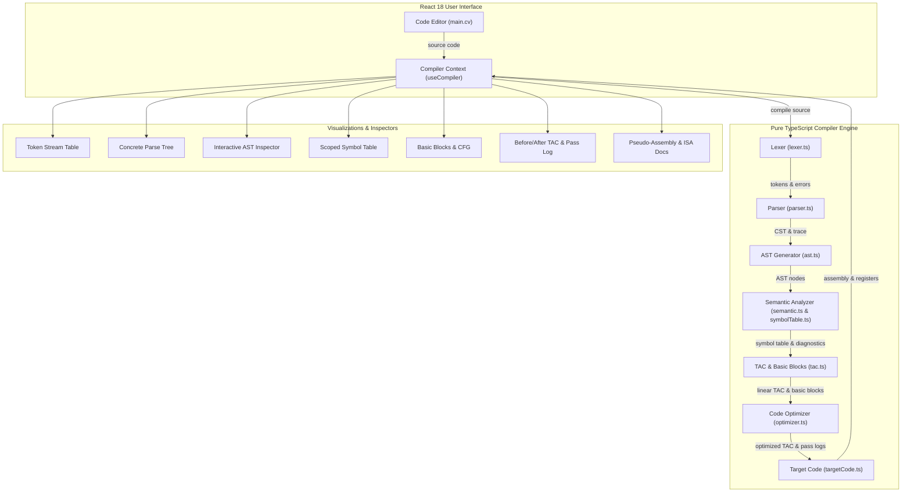

# CompilerVerse
### Understand Every Step. Visualize Every Transformation.

**A Professional Visual & Educational Compiler Tooling Platform**  
*Third-Year B.Tech Computer Science Compiler Design Assignment*  
**Problem Number:** 22 | **Track:** F – Visual and Educational Compiler Tooling  

---

## 1. Project Title and Description

**CompilerVerse** is an interactive, browser-based educational platform engineered to teach the fundamental principles of Compiler Design through visual simulation, live algorithmic execution, and cross-phase inspection.

Rather than treating compilation as a mysterious black box, CompilerVerse enables students to write programs in a documented C-like mini-language and witness how their code is systematically analyzed and transformed across all seven classic phases of compilation:
1. **Lexical Analysis (Scanning):** Characters $\to$ Typed Tokens with Source Spans.
2. **Syntax Analysis (Parsing):** Tokens $\to$ Concrete Parse Tree (CST) and derivation trace.
3. **AST Generation:** CST $\to$ Abstract Syntax Tree with stable IDs.
4. **Semantic Analysis:** Type checking, scope management, and Scoped Symbol Table.
5. **Intermediate Code Generation:** AST $\to$ Linearized Three-Address Code (TAC) and Basic Blocks.
6. **Code Optimization:** Constant Folding, Algebraic Simplification, Propagation, CSE, and DCE.
7. **Target Code Generation:** Optimized TAC $\to$ RISC-style pseudo-assembly with register allocation.

Additionally, CompilerVerse features standalone interactive visualizers for **LL(1) Predictive Parsing** and **Canonical LR(1) Bottom-Up Parsing**, **Python Manim educational animation scripts**, an **Adaptive Quiz Engine**, and a **Learning Progress Dashboard**.

---

## 2. Demo Screenshot & UI Overview

```
+-------------------------------------------------------------------------------------------------------+
|  CV  CompilerVerse v1.0   [Track F / Playground]     [Status: Verified 7/7]  [Story]  [Guide]  [Run]  |
+-------------------------------------------------------------------------------------------------------+
| SIDEBAR         | CODE EDITOR (main.cv)           | SYNCHRONIZED PHASE INSPECTOR                      |
|                 |                                 | [Tokens] [CST] [AST] [Symbols] [TAC] [Opt] [Asm]   |
| [Dashboard]     | 1 | int a = 10;                 |---------------------------------------------------|
| [Playground]    | 2 | int b = 20;                 | AST Node: BinaryExpression (+)                    |
| [Explorer]      | 3 | int c = a + b * 2;          |  |- Identifier (a)                                |
| [LL(1) Parser]  | 4 | print(c);                   |  `- BinaryExpression (*)                          |
| [LR(1) Parser]  |                                 |      |- Identifier (b)                            |
| [Lessons]       | [Load Example A v] [Run] [Clear]|      `- IntLiteral (2)                            |
| [Adaptive Quiz] |---------------------------------|---------------------------------------------------|
| [Progress]      | Output: 4 lines, 0 errors       | Associated TAC: c = a + t1                        |
| [About Project] | Status: Compiled in 12ms        | Target ASM:     ADD R3, R1, R2                    |
+-------------------------------------------------------------------------------------------------------+
```

---

## 3. Team Information

- **Track:** Track F – Visual and Educational Compiler Tooling
- **Assignment:** Problem 22
- **Degree:** B.Tech Computer Science & Engineering (Year 3)
- **Role:** Autonomous Architecture, Compiler Engine, Frontend & Testing Engineering

---

## 4. Problem Statement

Traditional compiler design education often suffers from high abstraction barriers. Students memorize theoretical concepts (such as Context-Free Grammars, FIRST and FOLLOW sets, LR item sets, and register allocation) without being able to observe how these mechanisms interact in a living software system. Existing production tools like GCC, Clang, or LLVM are too complex for introductory learners, while textbook pseudocode cannot be executed or debugged interactively.

**Problem 22 (Track F)** demands a self-contained, interactive educational platform that bridges this gap by implementing practical compiler and parsing algorithms from scratch in pure TypeScript/JavaScript, providing real-time visual feedback, and offering interactive parsing simulations without external AI backends or server dependencies.

---

## 5. Background Theory

### 5.1 The Seven Compiler Phases
1. **Lexical Analysis:** Decomposes source text into tokens $(T_i = \langle \text{Type}, \text{Lexeme}, \text{Span} \rangle)$ via Deterministic Finite Automata (DFA) and the Maximal Munch principle.
2. **Syntax Analysis:** Verifies context-free grammar compliance $A \to \alpha$, building a derivation tree and resolving operator precedence.
3. **Abstract Syntax Tree:** Condenses concrete punctuation into an operator-operand hierarchy.
4. **Semantic Analysis:** Enforces context-sensitive constraints (scope lifetime, declaration before use, type compatibility).
5. **Intermediate Code Generation:** Linearizes trees into Three-Address Code ($x = y \text{ op } z$) and partitions control flow into Basic Blocks via Leader Detection.
6. **Code Optimization:** Transforms TAC into semantically equivalent representations requiring fewer cycles or memory writes.
7. **Target Code Generation:** Maps variables and temporaries to machine registers ($R_1 \dots R_n$) and emits assembly instructions.

### 5.2 Parsing Theory: LL(1) vs. LR(1)
- **LL(1):** Left-to-right scan, Leftmost derivation, 1 lookahead token. Non-recursive top-down parsing guided by $M[A, a]$ table derived from $\text{FIRST}(\alpha)$ and $\text{FOLLOW}(A)$.
- **LR(1):** Left-to-right scan, Rightmost derivation in reverse, 1 lookahead token. Bottom-up shift-reduce parsing guided by canonical collection of LR(1) item sets $[A \to \alpha \bullet \beta, a]$ computed via $\text{CLOSURE}$ and $\text{GOTO}$.

---

## 6. Key Features

- **100% Pure TypeScript Compiler Engine:** No external lexer/parser libraries (no ANTLR, no Jison, no Babel). All algorithms written from first principles.
- **Synchronized Cross-Phase Linking:** Hovering over a source token or clicking an AST node highlights associated TAC lines, basic blocks, and assembly instructions simultaneously.
- **Interactive CST & AST Visualizer:** Expandable parse tree showing complete production rules applied alongside a compact AST.
- **Basic Block & Control Flow Graph (CFG) Partitioning:** Implements classical leader detection with predecessor and successor resolution.
- **Multi-Pass Optimizer:** Constant Folding, Algebraic Simplification ($x*1 \to x$, $x+0 \to x$), Constant/Copy Propagation, Common Subexpression Elimination, and Dead Code Elimination.
- **LL(1) Predictive Visualizer:** Algorithmic FIRST/FOLLOW fixed-point computation, conflict-free table verification, and stack animation with play/pause/step controls.
- **Canonical LR(1) Visualizer:** Dotted item closure computation, state transition graph, ACTION/GOTO tables, and step-by-step shift-reduce playback.
- **Educational Animation Scripts:** Python Manim Community Edition scripts (`ll1_parsing.py`, `lr1_parsing.py`) with built-in interactive web previews.
- **Adaptive Quiz Engine:** 11 compiler topics with automatic difficulty scaling (Beginner $\to$ Intermediate $\to$ Advanced) based on performance streaks.
- **Persistent Analytics Dashboard:** LocalStorage tracking of quiz attempts, topic mastery, and compilation statistics.
- **Narrative Story Mode:** Six animated personas (Lexer, Parser, AST, Semantics, Optimizer, Generator) explain their inner workings in beginner-friendly language.

---

## 7. Architecture & Data Flow



---

## 8. Installation

### Prerequisites
- **Node.js:** v18.0.0 or later (v24+ recommended)
- **npm:** v9.0.0 or later
- **Python (Optional, for Manim rendering):** v3.9+ with `pip install manim`

### Setup Commands
```bash
# Clone repository
git clone https://github.com/your-username/compilerverse.git
cd compilerverse

# Install frontend dependencies
npm install

# Run unit test suite
npm test

# Launch local development server
npm run dev
```
The application will launch locally at `http://localhost:3000`.

---

## 9. Usage & Quickstart Guide

1. Open **Compiler Playground** from the sidebar.
2. Select **Example A: Arithmetic & Precedence** from the dropdown:
   ```c
   int a = 10;
   int b = 20;
   int c = a + b * 2;
   print(c);
   ```
3. Click **Run Pipeline**.
4. Click through the phase tabs:
   - **Tokens:** Inspect token types, lexemes, and source offsets.
   - **Parse Tree:** Expand non-terminals to trace the recursive-descent reduction.
   - **AST:** Click the `BinaryExpression (+)` node to inspect its children and see the source code highlight.
   - **Symbols:** Confirm that `a`, `b`, and `c` are registered as initialized integers in the `global` scope.
   - **TAC:** Observe temporary variables `t1 = b * 2` and `t2 = a + t1`.
   - **Optimizer:** Review the transformation log showing Constant Folding.
   - **Target Code:** Examine emitted assembly with virtual registers `R1` to `R3`.
5. Open **LL(1) Visualizer** or **LR(1) Visualizer** to step through predictive stack derivations.

---

## 10. Worked Examples & Algorithms

### 10.1 FIRST and FOLLOW Worked Example
Given Grammar $G$:
- $E \to T E'$
- $E' \to + T E' \mid \varepsilon$
- $T \to F T'$
- $T' \to * F T' \mid \varepsilon$
- $F \to ( E ) \mid \text{id}$

**Computed Sets:**
- $\text{FIRST}(F) = \{ (, \text{id} \}$
- $\text{FIRST}(T') = \{ *, \varepsilon \}$
- $\text{FIRST}(T) = \{ (, \text{id} \}$
- $\text{FIRST}(E') = \{ +, \varepsilon \}$
- $\text{FIRST}(E) = \{ (, \text{id} \}$
- $\text{FOLLOW}(E) = \text{FOLLOW}(E') = \{ ), \$ \}$
- $\text{FOLLOW}(T) = \text{FOLLOW}(T') = \{ +, ), \$ \}$
- $\text{FOLLOW}(F) = \{ *, +, ), \$ \}$

### 10.2 LL(1) Parsing Table $M[A, a]$
| NT | id | + | * | ( | ) | $ |
| :---: | :---: | :---: | :---: | :---: | :---: | :---: |
| **E** | $E \to T E'$ | - | - | $E \to T E'$ | - | - |
| **E'** | - | $E' \to + T E'$ | - | - | $E' \to \varepsilon$ | $E' \to \varepsilon$ |
| **T** | $T \to F T'$ | - | - | $T \to F T'$ | - | - |
| **T'** | - | $T' \to \varepsilon$ | $T' \to * F T'$ | - | $T' \to \varepsilon$ | $T' \to \varepsilon$ |
| **F** | $F \to \text{id}$ | - | - | $F \to ( E )$ | - | - |

*(Every entry has at most 1 rule $\implies$ Strictly deterministic LL(1))*

### 10.3 Canonical LR(1) Shift-Reduce on `id + id * id`
1. State $I_0$, Symbol $\$$, Input `id + id * id $` $\to$ **Shift id (Goto $I_5$)**
2. State $I_5$, Symbol `id`, Input `+ id * id $` $\to$ **Reduce $F \to \text{id}$ (Goto $I_3$)**
3. State $I_3$, Symbol $F$, Input `+ id * id $` $\to$ **Reduce $T \to F T'$ (Goto $I_2$)**
4. State $I_2$, Symbol $T$, Input `+ id * id $` $\to$ **Shift +**
5. ... Bottom-up reduction continues until State $I_1$ with lookahead $\$$ $\to$ **ACCEPT!**

### 10.4 Three-Address Code & Basic Blocks
**Source:**
```c
int i = 0;
int sum = 0;
while (i < 5) {
    sum = sum + i;
    i = i + 1;
}
print(sum);
```
**Linear TAC:**
```
i = 0
sum = 0
L1:
t1 = i < 5
if_false t1 goto L2
sum = sum + i
i = i + 1
goto L1
L2:
print sum
```
**Partitioned Basic Blocks:**
- **Block 1 (Entry):** `i = 0`, `sum = 0` $\to$ Successor: Block 2
- **Block 2 (Loop Header / Leader L1):** `L1:`, `t1 = i < 5`, `if_false t1 goto L2` $\to$ Successors: Block 3, Block 4
- **Block 3 (Loop Body):** `sum = sum + i`, `i = i + 1`, `goto L1` $\to$ Successor: Block 2
- **Block 4 (Loop Exit / Leader L2):** `L2:`, `print sum` (Exit)

### 10.5 Code Optimization Example
**Before Optimization:**
```
p = 5 + 15
q = p * 1
r = q + 0
dead = 999
print r
```
**After Multi-Pass Optimization (60% Code Reduction):**
```
p = 20
print 20
```
- Pass 1: Constant Folding evaluated `5 + 15` $\to$ `20`.
- Pass 2: Algebraic Simplification transformed `p * 1` $\to$ `p` and `q + 0` $\to$ `q`.
- Pass 3: Copy & Constant Propagation substituted `20` into `print r`.
- Pass 4: Dead-Code Elimination purged unused temporaries `dead`, `q`, and `r`.

### 10.6 Target Pseudo-Assembly Output
```assembly
LOAD R1, #10
STORE a, R1
LOAD R2, #20
STORE b, R2
LOAD R1, b
MUL R1, R1, #2
STORE t1, R1
LOAD R2, a
LOAD R1, t1
ADD R3, R2, R1
STORE c, R3
PRINT c
HALT
```

---

## 11. Automated Testing

CompilerVerse includes a comprehensive Vitest test suite covering all modules:
```bash
npm test
```
**Test Results:**
```
 ✓ tests/quiz.test.ts (4 tests)
 ✓ tests/parsing.test.ts (9 tests)
 ✓ tests/compiler.test.ts (15 tests)

 Test Files  3 passed (3)
      Tests  28 passed (28)
   Duration  2.67s
```

### Production Build Verification
```bash
npm run build
```
Builds cleanly with zero TypeScript errors into the `dist/` production bundle (1599 modules transformed, 364 kB JS, 42 kB CSS).

---

## 12. Limitations & Future Work

- **Language Scope:** The current language supports integer types (`int`), arithmetic, relational comparisons, `if-else` branches, and `while` loops. Floating-point numbers, arrays, and functions are planned for v2.0.
- **Register Spilling:** Target code generation utilizes 6 virtual registers ($R_1 \dots R_6$) with round-robin mapping; graph-coloring register allocation with memory spilling is identified as future work.
- **LR(1) Automaton Visual Layout:** State transition diagrams are presented as interactive state item cards; an SVG force-directed graph renderer can be integrated in future releases.

---

## 13. Demo Video & Animation Instructions

### Rendering Manim Animations Locally
CompilerVerse includes two complete Python Manim Community Edition animation scripts in `animations/`:
1. `ll1_parsing.py` (Class: `LL1ParsingScene`)
2. `lr1_parsing.py` (Class: `LR1ParsingScene`)

**To render high-resolution MP4 videos:**
```bash
# 1. Install Manim Community Edition
pip install manim

# 2. Render LL(1) Animation (saved to public/videos/)
manim -pql animations/ll1_parsing.py LL1ParsingScene -o ../public/videos/ll1_parsing.mp4

# 3. Render LR(1) Animation (saved to public/videos/)
manim -pql animations/lr1_parsing.py LR1ParsingScene -o ../public/videos/lr1_parsing.mp4
```
*(Interactive web-based step-by-step simulations are also built directly into the Animated Lessons page for immediate browser viewing).*

---

## 14. Credits & References

1. **Aho, A. V., Lam, M. S., Sethi, R., & Ullman, J. D.** (2006). *Compilers: Principles, Techniques, and Tools* (2nd ed.). Addison-Wesley (The "Dragon Book").
2. **Cooper, K. D., & Torczon, L.** (2011). *Engineering a Compiler* (2nd ed.). Morgan Kaufmann.
3. **Manim Community Developers.** (2024). *Manim – Mathematical Animation Engine*. https://www.manim.community/
4. **React & Tailwind CSS Communities** for component and styling primitives.
